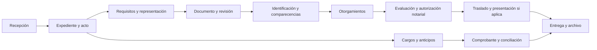

# Producto, procesos y pantallas

Versión de planificación, 29/10/2026. Una notaría; marca, oficinas, usuarios y actos prioritarios pendientes. No describe una operación ya validada por un notario.

## 1. Actores y responsabilidades propuestas

| Perfil | Trabajo principal | Límite relevante |
| --- | --- | --- |
| Recepción | Registrar solicitud/personas, verificar faltantes y orientar | No autoriza instrumentos ni excepciones |
| Abogado/redactor | Revisar requisitos, representación y documentos | No sustituye autorización del notario |
| Identificación | Ejecutar procedimiento habilitado y registrar evidencia | No convierte no coincidencia en aprobación |
| Notario habilitado | Evaluación y actos que le correspondan; excepciones y autorización | Habilitación y vigencia registradas; sin delegación automática |
| Caja | Cargos, pagos, aplicaciones, comprobantes y cierre | Cambios de reglas/series y ajustes con facultades específicas |
| Archivo | Custodia, traslados/entregas y ubicación | Acceso limitado por documento y reserva |
| Cumplimiento | Diligencia y revisión reservada según régimen | Alertas no expuestas a clientes o usuarios generales |
| Privacidad | Solicitudes, incidentes y retención | Identidad verificada y fundamento de cada decisión |
| TI | Configuración y soporte técnico | Sin facultad notarial ni acceso ordinario a contenido reservado |
| Auditor | Consulta de evidencia permitida | Lectura acotada, sin cambios ni exportación universal |

Un usuario puede tener varios perfiles si se autoriza; las incompatibilidades se configuran explícitamente. Los perfiles no son afirmaciones de cargos obligatorios del cliente.

## 2. Recorrido protocolar propuesto



El diagrama es un flujo de producto a validar por acto; no impone idéntico orden legal para todos los servicios. La fecha de facturación se define por obligación tributaria, no por este dibujo.

| Paso | Entrada y salida | Alternativa o control |
| --- | --- | --- |
| Recepción | Solicitud → expediente/kardex, acto y responsable | Detectar posible duplicado y solicitar revisión; no fusionar personas por nombre |
| Intervinientes | Datos mínimos → participación/calidad y documentos | Representantes, poderes, cónyuge, testigos/intérpretes según acto |
| Requisitos | Catálogo versionado → lista de revisión | Faltante genera observación, responsable y evidencia; no solo una casilla |
| Documento | Minuta aportada/elaborada → versión revisada | Faltantes, abogado autorizante si procede y conflicto de edición |
| Identidad | Método y persona → verificación vinculada | Fallo técnico, no coincidencia y excepción se distinguen |
| Otorgamientos | Versión y persona → evidencia de comparecencia | Firmas pendientes, nueva comparecencia, cambio de versión |
| Autorización | Requisitos y decisión profesional → instrumento autorizado | Bloqueo por falta de facultad, evidencia o versión; corrección por procedimiento |
| Traslado | Instrumento/versiones → parte/testimonio | Firmar y preparar no equivale a presentar; exigir cargo para estado enviado |
| Entrega | Recurso y destinatario autorizado → constancia | Entrega parcial, representante y reserva; archivo mínimo relacionado |
| Finanzas | Cargos/pagos → aplicaciones, saldo y cierre | No duplicar pago al facturar; ajustes y devoluciones con referencia |

## 3. Recorridos extraprotocolares

**Certificación de firmas:** solicitud → documento/comparecientes → requisitos e identificación aplicables → actuación del notario → constancia/documento de salida → entrega y registro financiero. No reutilizar el flujo de escritura ni exigir minuta por defecto.

**Carta notarial:** solicitud → documento y destinatario → revisión → programación/asignación → intento de diligencia → resultado y constancia → entrega/archivo. Debe soportar varios intentos, resultado distinto de entrega y evidencia pertinente al procedimiento. Requisitos y efecto de cada resultado se validan con el notario.

**Asuntos no contenciosos:** fuera del primer alcance comprometido. Requieren procedimiento por tipo, publicaciones, calendario y tratamiento de oposición, sin extrapolar las etapas de compraventa.

## 4. Reglas de interacción

- Separar estado administrativo del expediente, estado del instrumento, identificación, pago y presentación externa.
- Siguiente acción con faltantes concretos: «Falta verificar a un interviniente» o «La versión cambió; requiere revisión».
- Tareas/requisitos con responsable, fecha, origen y evidencia; usar texto e icono además del color.
- Distinguir fecha de negocio, captura en sistema y momento de respuesta de proveedor.
- Reapertura/corrección como acción registrada; no editar silenciosamente historia autorizada.
- Búsqueda por documento/kardex/acto y filtros, aplicando autorización antes de devolver coincidencias.
- Toda simulación muestra un rótulo persistente y resultados ficticios; una animación no sustituye lectura real.

## 5. Navegación y pantallas

| ID | Ruta propuesta | Contenido/acción principal | Prototipo |
| --- | --- | --- | --- |
| UI-01 | `/acceso` | Notaría, credenciales, recuperación y MFA simulado | Completo visual |
| UI-02 | `/inicio` | Mis pendientes, vencimientos y accesos por perfil | Completo visual |
| UI-03 | `/expedientes` | Bandeja/kanban, filtros, búsqueda y nuevo expediente | Completo visual |
| UI-04 | `/expedientes/nuevo` | Selección de acto y datos mínimos | Completo visual |
| UI-05 | `/expedientes/[id]` | Resumen, participantes, requisitos, tareas, pagos e historial | Completo visual |
| UI-06 | `/personas` y `/personas/[id]` | Personas/representación y vínculos permitidos | Recorrido principal |
| UI-07 | `/expedientes/[id]/identificacion` | Interviniente activo, método, resultado y contingencia | Simulación visible |
| UI-08 | `/documentos/[id]/revision` | Documento, variables/faltantes, versiones y revisión | Recorrido principal |
| UI-09 | `/instrumentos/[id]` | Registro, folios, otorgamientos y autorización | Vista de revisión |
| UI-10 | `/caja` | Cargos, anticipos, pago, aplicaciones y comprobantes | Recorrido principal |
| UI-11 | `/expedientes/[id]/entrega` | Destinatario y constancia; preparación de traslado | Recorrido principal |
| UI-12 | `/diligencias` | Intentos de carta y resultado | Recorrido carta |
| UI-13 | `/cumplimiento/plaft` | Bandeja reservada de revisión y exportaciones | Vista prevista, sin funcionalidad real |
| UI-14 | `/cumplimiento/privacidad` | ARCO, incidentes y retención | Vista prevista |
| UI-15 | `/configuracion` | Perfiles, oficina, tarifario, políticas e integraciones | Muestra de alcance |
| UI-16 | `/agenda` y `/sala` | Citas/compareciente activo en tablet | Boceto para ampliación |
| UI-17 | `/portal` | Estado/documentos autorizados de un cliente ficticio | Boceto futuro |

Las rutas son propuestas de diseño, no endpoints implementados. Menús filtrados por perfil sin sustituir los permisos del servidor. El buscador usa `Ctrl+K`/`Cmd+K` y mantiene el alcance del usuario.

## 6. Dirección visual específica

**Propuesta inicial sustituida por indicación expresa de André:** misma interfaz y estética de ElDial, con Montserrat, ELDIAL_THEME rojo, navegación superior compacta y composición original del login. La tabla y el esquema siguientes documentan la propuesta anterior; no deben guiar nuevas pantallas. Dirección vigente: [fase 1](../phase-1/diseno.md).

| Token/rol | Propuesta | Uso |
| --- | --- | --- |
| `ink` | `#0B1F3A` | Títulos, acción primaria y navegación |
| `canvas` | `#F4F2EE` | Lienzo de trabajo |
| `surface` | `#FFFFFF` | Documento/panel |
| `text` | `#17243A` | Texto de lectura |
| `muted` | `#526174` | Metadatos legibles, contraste por verificar |
| `ornament` | `#B08D57` | Acento decorativo, sin depender de él para texto/foco |

Plus Jakarta Sans para interfaz/títulos, 14–16 px en datos según densidad y 16 px en formularios; escala 20/24/30 para jerarquías. Fuentes locales con licencia preservada. Phosphor en una sola familia; números tabulares. La visualización final medirá contraste en vez de asumirlo por el color.

Composición de escritorio propuesta: navegación lateral compacta de 216 px, barra superior con búsqueda/contexto y área de trabajo flexible. En expediente, panel principal documental y panel lateral de requisitos; el historial puede abrirse sin perder el documento. El menú de muchos módulos no debe desbordar la barra superior.

```text
┌───────────────┬────────────────────────────────────────────┐
│ NotariaOS     │ Buscar expediente       Oficina / perfil   │
│ Inicio        ├────────────────────────────────────────────┤
│ Expedientes   │ Kardex · Acto · Estado     Siguiente acción │
│ Personas      ├─────────────────────────┬──────────────────┤
│ Documentos    │ Documento / actividades │ Intervinientes   │
│ Caja          │                         │ Requisitos       │
│ Cumplimiento  │                         │ Faltantes        │
│ Configuración │                         │ Evidencia        │
└───────────────┴─────────────────────────┴──────────────────┘
```

Alternativa descartada como base: copiar toda la navegación horizontal de retail; es compacta, pero el expediente necesita más espacio de revisión y módulos con reservas distintas. Se conserva su densidad y respuesta de componentes.

En móvil, menú en panel, cabecera breve y pestañas horizontales acotadas; revisión y requisitos se alternan sin comprimir un A4 ilegible. En tablet/sala solo datos del compareciente activo. Modo oscuro funcional, sin retrasar la validación inicial del tema claro.

## 7. Validación del diseño en fase 1

Pantallas 1366×768, 1280×1024, 1024×768 y 390×844; zoom, teclado, orden de foco, errores asociados, contraste, rótulos de simulación y estados de proveedor. Objetivo WCAG 2.2 AA con revisión manual y automatizada cuando exista UI.

Control táctil recomendado 44×44 px en tablet/móvil; alternativa de botones para movimientos del kanban; paginador y filtros accesibles. Animación 150–250 ms para cambios de estado, sin efectos de entrada en cada fila ni video obligatorio. Respetar movimiento reducido.

Caso de revisión visual: abrir expediente, encontrar un requisito faltante, corregirlo, cambiar versión, registrar un resultado no concluyente, revisar un anticipo y completar entrega sintética. La explicación del bloqueo y la reversibilidad deben ser comprensibles sin conocer la arquitectura.

## 8. Matriz inicial de facultades

Propuesta de mínimos para validar con la notaría; cada permiso de lectura sigue limitado por reserva y necesidad. No es una autorización concedida ni reemplaza habilitación profesional.

| Recurso/acción | Perfiles candidatos | Condición o separación |
| --- | --- | --- |
| Personas: registrar/actualizar | Recepción, asistente, abogado | Cambios no alteran instantáneas históricas; registro de evidencia |
| Expediente: crear/asignar/tareas | Recepción, asistente, abogado | Alcance y responsables; cambios de acto/requisitos revisados |
| Documentos: redactar/revisar | Abogado/redactor | Revisión/aprobación por persona facultada y versión exacta |
| Identidad: ejecutar | Identificación, notario | Método habilitado y resultado no manipulable |
| Identidad: aprobar excepción | Notario habilitado | Reautenticación, fundamento y evidencia individual |
| Instrumento: autorizar | Notario habilitado | Requisitos, otorgamientos, representación y versión bajo evaluación |
| Traslado: preparar/entregar | Archivo/asistente autorizado | Preparar no firma; destinatario y reserva comprobados |
| Firma: ejecutar | Titular facultado del certificado | Clave/PIN bajo su control; alcance del documento validado |
| Cobros/comprobantes/cierre | Caja, responsable financiero | Reglas aprobadas; descuentos/devoluciones con facultades adicionales |
| Series/impuestos | Responsable financiero autorizado | Revisión tributaria, vigencia y auditoría |
| PLAFT: revisar/exportar | Cumplimiento, notario según régimen | Reserva específica; no accesible por rol administrativo general |
| Privacidad: gestionar | Responsable de privacidad y facultados | Verificación del solicitante y conservación aplicable |
| Permisos/configuración técnica | Administrador autorizado | No adquiere lectura de contenido reservado; doble revisión crítica según política |
| Auditoría: consultar/exportar | Auditor facultado y responsables específicos | Alcance limitado y acceso también auditado |

Una acción deshabilitada muestra causa comprensible cuando no revele información reservada. Acceso directo por URL, descarga o API conserva las restricciones aunque el menú no se muestre.
