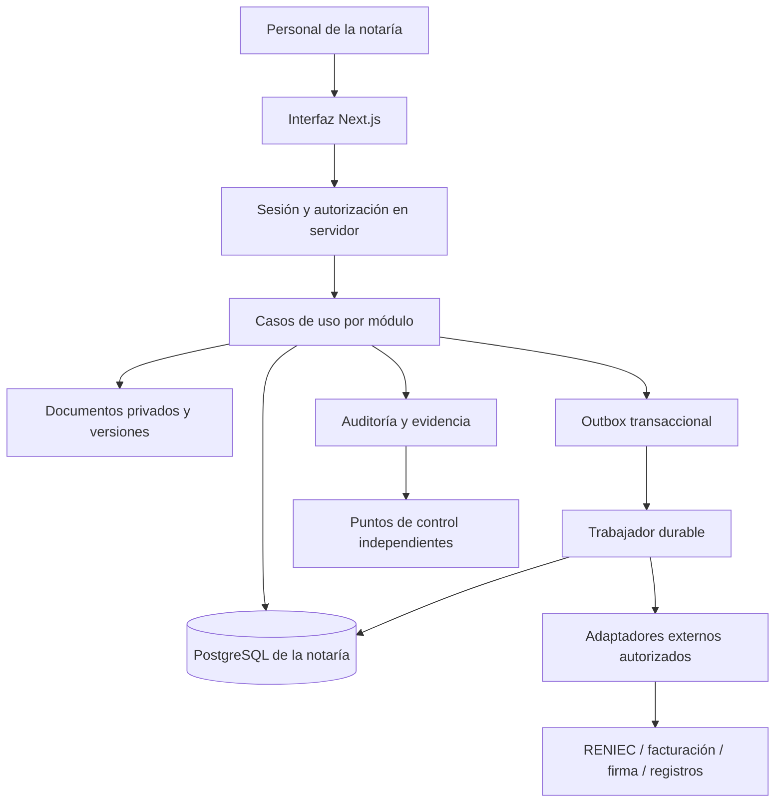
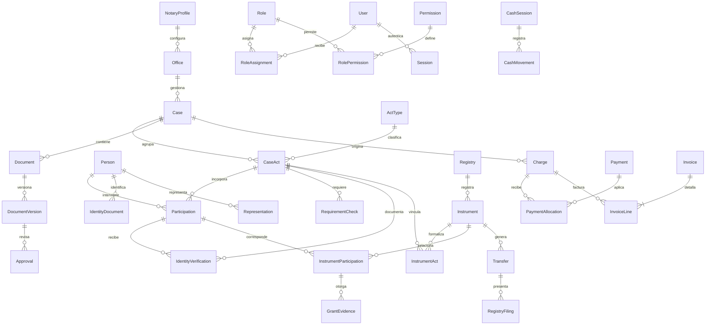

# Arquitectura y modelo conceptual

Propuesta para una notaría, 29/10/2026. Documento conceptual de fase 0. La fase 2 ya aplica fundamentos locales y esquema PostgreSQL embebido con Better Auth/Kysely; ver [ADR 0002](../adr/0002-fundamentos-locales-y-paleta-juridica.md). No hay infraestructura operativa aprovisionada.

## 1. Forma de la solución

Monolito modular TypeScript; Next.js/React como interfaz y frontera HTTP; PostgreSQL como persistencia relacional; Prisma candidato por afinidad con ElDial. Almacenamiento privado de objetos para documentos; trabajador durable para envíos, reportes y conciliación cuando se implemente su necesidad.



El diagrama presenta responsabilidades; no exige procesos separados desde el prototipo. El trabajador y almacenamiento se concretan al seleccionar alojamiento. Un cron puede despertar el procesador, pero no reemplaza una cola durable con estado y reintentos.

## 2. Límites del sistema

- Una notaría y una BD operativa. Oficinas, cajas y series pertenecen a ella y su habilitación se valida por negocio.
- Sin plano de control multi-notaría, billing SaaS, registro de planes, cambio de empresa o aprovisionamiento masivo.
- Entornos desarrollo/pruebas/producción separados con cuentas/llaves diferentes. No usar BD de ElDial para NotariaOS.
- Identidad corporativa, oficina y features son configuración; no son mecanismos de autorización.
- Posible evolución futura a varias instalaciones independientes mediante módulos y configuración. No construir tenancy anticipadamente.

## 3. Módulos y dependencias

| Módulo | Propiedad del dato/reglas | Puede depender de |
| --- | --- | --- |
| Plataforma | Usuarios, sesiones, roles/permisos y configuración | Proveedor de identidad y almacenamiento seguro |
| Personas | Ficha, documentos de identidad y representación | Plataforma; referencias documentales |
| Expedientes | Actos, participantes, requisitos, tareas y plazos | Personas; políticas/versiones |
| Documentos | Plantillas, versiones, revisiones y aprobaciones | Permisos; almacenamiento; expediente por referencia |
| Identificación | Procedimiento, resultado, excepción y evidencia | Personas; expediente; proveedor habilitado |
| Instrumentos | Registros, asignación de números, folios, otorgamientos y autorización | Expediente; identidad; documentos |
| Finanzas | Cargos, anticipos, aplicaciones, comprobantes, movimientos/cierres | Expediente por ID; reglas tributarias aprobadas |
| Cumplimiento | Debida diligencia, reserva, solicitudes e incidentes | Datos mínimos de casos/personas y políticas |
| Traslados/archivo | Copias, presentación/cargo, entrega y ubicación | Instrumento autorizado; firma/registro según canal |
| Reportes | Proyecciones/lecturas autorizadas | Contratos de consulta, sin modificar datos de origen |

Evitar que el módulo financiero importe componentes de pantalla o que el proveedor de identidad controle estados del expediente. Los casos de uso coordinan módulos mediante contratos explícitos, transacciones o eventos según necesidad.

## 4. Estructura propuesta de código

```text
src/app/                         Rutas y composición
src/modules/<module>/domain/    Invariantes y políticas puras
src/modules/<module>/application/ Casos de uso y contratos
src/modules/<module>/infrastructure/ Prisma/proveedores
src/modules/<module>/ui/        Componentes propios del módulo
src/platform/auth/             Sesión y recuperación
src/platform/authorization/    Permisos y contexto de acceso
src/platform/audit/            Evidencia y verificación
src/platform/jobs/             Outbox, trabajos y reintentos
src/platform/storage/          Objetos/versiones y descargas
src/shared/ui/                 Piezas extraídas de ElDial y adaptadas
src/shared/time/                Fecha civil, instantes y zona Lima
docs/adr/                       Decisiones y evolución
```

Registro de módulos explícito y tipado. Manifiestos para navegación, permisos, reportes y tareas; rutas del framework y migraciones coordinadas. No prometer plugins que descubran pantallas en tiempo de ejecución.

## 5. Modelo de datos inicial

Diagrama deliberadamente conceptual: faltan campos, índices y cardinalidades definitivas por acto. No equivale a esquema de producción.



Registros de soporte: `PolicyVersion`, `TemplateVersion`, `RepresentationEvidence`, `NumberAllocation`, `SignatureEvidence`, `ArchiveLocation`, `DeliveryEvidence`, `RiskReview`, `RegulatoryExport`, `PrivacyPurpose`, `ConsentEvidence`, `DataSubjectRequest`, `Incident`, `RetentionPolicy`, `LegalHold`, `AuditEvent`, `OutboxEvent`, `ProviderCall`, `Job`, `Reconciliation`.

No todos los actos generan instrumento protocolar. Las tablas puente permiten validar múltiples actos por instrumento sin imponer esa relación universal. Las escrituras/folios y registros exigibles deben concretarse con asesor/notario.

### Persistencia de información histórica

- Documento y plantilla con versiones estables; revisión/aprobación refiere a una versión exacta.
- Participación e instrumento conservan instantánea de identidad, calidad, representación y datos usados, evitando que una ficha actualizada reescriba historia.
- La evidencia de identidad enlaza comparecencia/participación y el acto que la requiere; su reuso no es global o indefinido.
- El estado original de proveedor se conserva junto al normalizado y a la versión del adaptador.
- Guardar fecha efectiva de negocio, instante de registro y actor. No permitir editar fechas sensibles sin procedimiento autorizado.

## 6. Transacciones y concurrencia

**Numeración:** definir el ámbito por registro/política. Restricción única y asignador transaccional; reserva y asignación con estados, sin reciclaje. No usar `MAX + 1`. Probar paralelismo y recuperaciones tras fallo, sin prometer que un contador técnico garantiza por sí solo continuidad jurídica.

**Dinero:** importes con decimal exacto (escala propuesta 2 para totales; mayor para precios/tipos de cambio según cálculo validado), moneda y regla de redondeo. PostgreSQL `numeric`/Prisma `Decimal` como candidatos, sin conversión silenciosa a `number` en reglas monetarias. API serializa importes como cadenas decimales. Precisión final se aprueba con casos de facturación.

**Pagos:** recepción, confirmación, asignación y comprobante separados. Clave de idempotencia única con huella del pedido; reutilizar clave con contenido distinto produce conflicto. Referencias externas únicas cuando existan.

**Documentos:** bloqueo optimista por versión esperada. Documento firmado no mutable; revisión sobre bytes y versión concretos. La descarga aplica permisos antes de emitir un enlace temporal.

**Estado externo desconocido:** persistir intención antes del envío; timeout no equivale a rechazo. Consultar/reconciliar antes de repetir. La respuesta externa y el registro local no forman una transacción distribuida; prever recuperación de efectos ya ocurridos.

## 7. Autenticación, permisos y auditoría

El componente de acceso de ElDial es una referencia de interacción, no una solución de MFA/revocación ya aceptada. Spike de fase 2 para decidir si adaptar biblioteca compatible o usar proveedor gestionado, comprobando recuperación, MFA, revocación, soporte y costos. No desarrollar primitivas criptográficas propias.

Permiso propuesto: `case:read`, `case:update`, `identity:verify`, `identity:approve-exception`, `instrument:authorize`, `document:export`, `invoice:issue`, `cash:close`, `compliance:review`, `privacy:manage`, `settings:permissions`.

Cada autorización considera sesión vigente, habilitación/rol, alcance de oficina o caso si procede, reserva del recurso, estado y autenticación reciente. TI no recibe `instrument:authorize` por defecto. Cambio de permisos invalida o reevalúa acceso efectivo.

Los controles se ejecutan cerca de los datos, en casos de uso y puntos de entrada; `proxy` puede adelantar redirecciones. Esta separación coincide con la guía oficial de [autenticación/autorización de Next.js](https://nextjs.org/docs/app/guides/authentication).

Auditoría crítica transaccional donde sea posible; para lecturas sensibles, registrar acceso autorizado antes de devolver el recurso. Fallos no se descartan en silencio. Minimizando contenido, registrar actor/recurso/acción/resultado/correlación/fecha; protección contra modificaciones y puntos de control independientes según amenaza acordada.

Una cadena de hashes necesita serialización y orden de concurrencia definidos; no usarla como afirmación de inviolabilidad. Entrega de objetos, reportes, búsqueda y trabajos tienen la misma política de reserva.

## 8. Integraciones y modos

| Puerto | Modo inicial | Requisito para modo real |
| --- | --- | --- |
| `IdentityVerifier` | Simulado, resultados controlados | Convenio, canal, dispositivo/SDK y evidencia de respuesta |
| `InvoiceProvider` | Simulado; SmartPSE candidato | Documentación, cuenta demo autorizada y pruebas con XML/CDR |
| `DigitalSigner` | Simulado o importación asistida según flujo aprobado | Producto/certificado habilitados, control de clave, formato y validación |
| `RegistryGateway` | Asistido | Acceso directo solo si documentado/autorizado; cargo verificable |
| `ComplianceExporter` | Borrador local | Formato/calendario/canal validados y constancia de recepción |
| `Notifier` | Bandeja simulada | Proveedor/plantillas autorizados, finalidad y registro de entrega |
| `FileStore` | Almacenamiento de prueba aislado | Acceso privado, claves, versión, retención y restauración |
| `Clock`/calendario | Controlado en pruebas | Zona Lima, reglas por plazo y feriados de procedencia validada |

Pruebas de contrato para capacidades, errores, timeouts y duplicados. Respuestas de proveedores y documentos son datos no confiables, no instrucciones para ejecutar código.

## 9. Infraestructura y operación pendientes

Seleccionar alojamiento con compatibilidad de Next/Node, PostgreSQL, almacenamiento y trabajos; evaluar región y transferencia de datos antes de contratar. No elegir Vercel/Neon solo porque están en la referencia.

Candidatos de arquitectura: aplicación y trabajador en servicio administrado, o despliegue de aplicación con trabajador independiente. Decisión después de comprobar lector local, conexiones, presupuesto y operación de la notaría. No hay instalación ni pago autorizado en fase 0.

Objetivos por validar: RPO 15 min/RTO 4 h, p95 2 s para acciones internas y 1 s para búsqueda bajo dataset/carga declarados. No son SLA. Selección de infraestructura incluye prueba de restauración de documentos/llaves, no solo BD.

Migraciones coordinadas con respaldo y estrategia expand/contract. Producción requiere monitoreo, reintentos, runbooks y revisión de seguridad. No se usa `db push` como procedimiento automático de producción por herencia del README retail.
